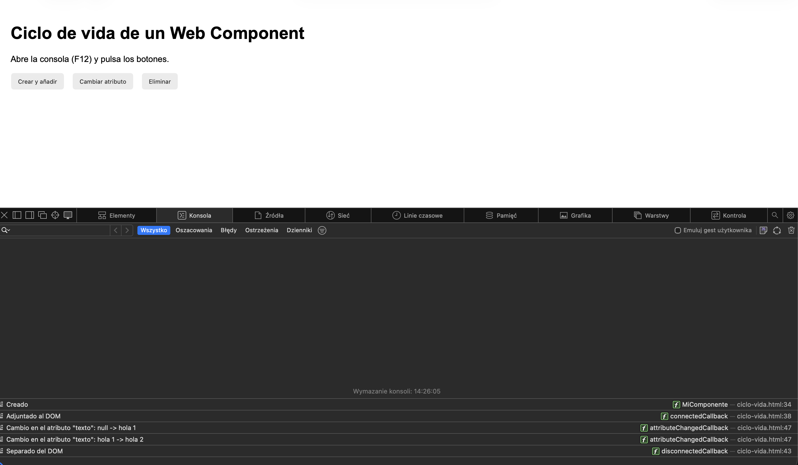
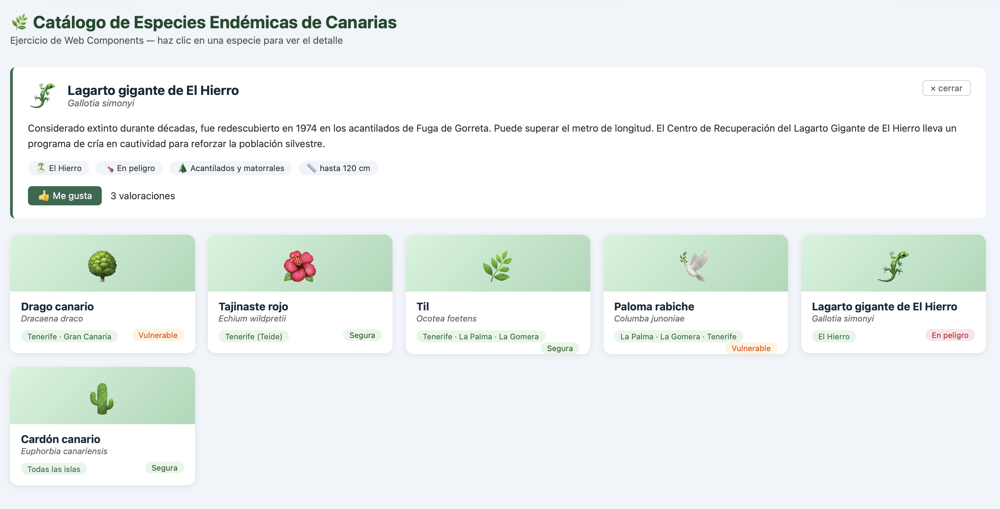

# Web Components - Práctica 1

Alumno: Jakub Gugulski (Erasmus)

## Ejercicio 1 - Ciclo de vida de un Web Component

Archivo: `ciclo-vida.html`

He creado el componente `<mi-componente>` que muestra un mensaje en consola en cada fase de su ciclo de vida:

| Fase                     | Callback                     | Mensaje                  |
|--------------------------|------------------------------|--------------------------|
| Creado                   | `constructor()`              | Creado                   |
| Adjuntado al DOM         | `connectedCallback()`        | Adjuntado al DOM         |
| Separado del DOM         | `disconnectedCallback()`     | Separado del DOM         |
| Cambio en los atributos  | `attributeChangedCallback()` | Cambio en el atributo... |

Para que `attributeChangedCallback` funcione, el atributo `texto` tiene que estar en `observedAttributes`.

La página tiene 3 botones para probarlo: crear y añadir el componente, cambiar el atributo y eliminarlo.

## Ejercicio 2 - Valoraciones de especies

Archivo: `especies.html`

Partiendo del ejemplo de clase, he añadido el componente `<especie-valoracion>` dentro del panel de detalle. Los cambios están marcados con el comentario `AÑADIDO`.

- El componente tiene un botón "Me gusta" y muestra el número de valoraciones, que recibe en el atributo `valoraciones` (observado con `observedAttributes` y `attributeChangedCallback`).
- Al pulsar el botón lanza el evento `especie-valorada` (`bubbles` y `composed`).
- `<especie-detalle>` escucha ese evento, suma 1 a la especie que está mostrando y actualiza el atributo del componente.
- Cada especie guarda sus valoraciones en el campo `valoraciones` de su objeto, por eso al abrir otra especie se ve su propio contador.

