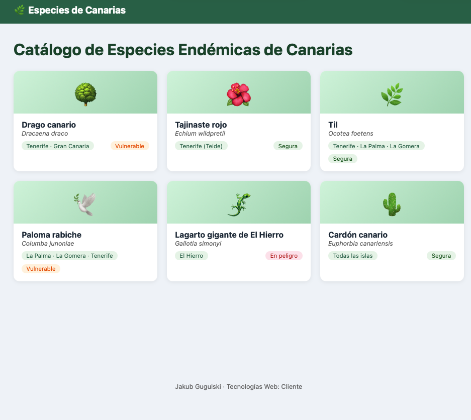
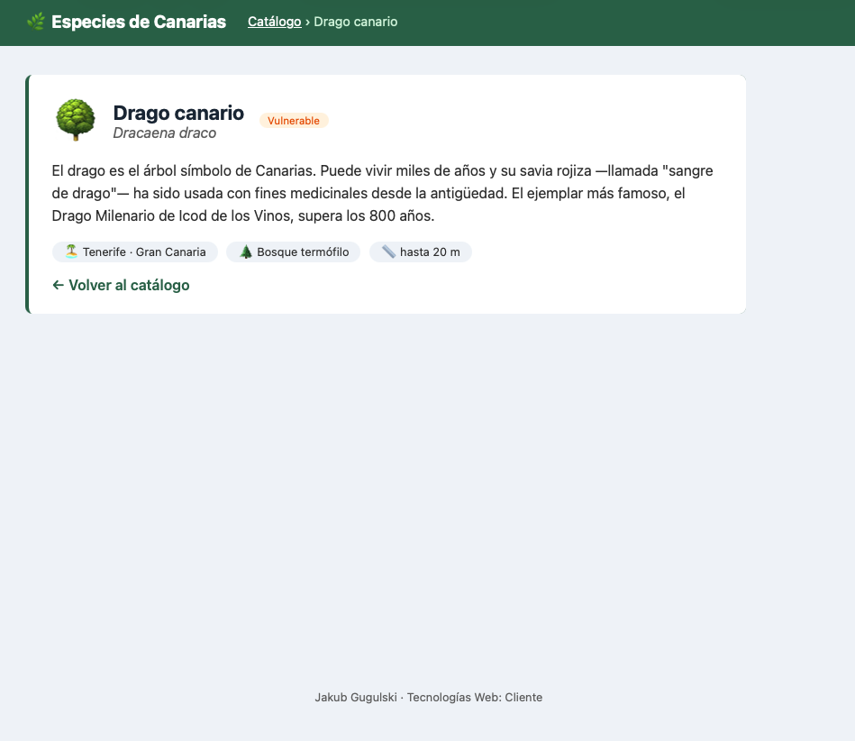
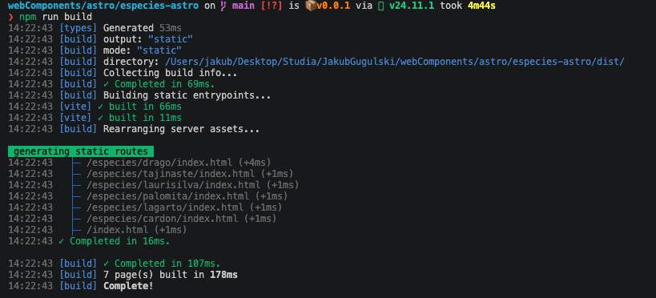

# Generación de sitios estáticos con Astro

Alumno: Jakub Gugulski (Erasmus)

Catálogo de especies endémicas de Canarias rehecho con Astro, a partir del ejemplo de Web Components. El panel de detalle desaparece y cada especie tiene su propia página con su propia URL.

## Cómo ejecutarlo

```
npm install
npm run dev     # servidor de desarrollo en http://localhost:4321
npm run build   # genera el sitio estático en dist/
```

## Estructura

```
src/
├── data/especies.js
├── layouts/BaseLayout.astro
├── components/
│   ├── BadgeAmenaza.astro
│   ├── Chip.astro
│   ├── EspecieCard.astro
│   └── Tarjeta.astro
└── pages/
    ├── index.astro
    └── especies/[id].astro
```

## Pasos realizados

1. **Proyecto y datos**: proyecto Astro vacío con el array de especies en `src/data/especies.js`. El id `cardón` se ha cambiado a `cardon` para que sea válido en una URL.
2. **Layout**: `BaseLayout.astro` con cabecera, pie y `<slot />` para el contenido. Recibe la prop `titulo` para el `<title>` de cada página.
3. **BadgeAmenaza.astro**: recibe la prop `nivel` (EN, VU, LC, con LC por defecto) y muestra la etiqueta con su color.
4. **Lista con map**: en `index.astro` se importan los datos en el frontmatter y se recorren con `map`. El HTML se genera al compilar, sin JavaScript en el navegador.
5. **Tarjeta.astro**: tarjeta genérica que no sabe nada de especies, con slots con nombre (`icono`, `titulo`) con contenido por defecto y un slot por defecto.
6. **EspecieCard.astro**: usa `Tarjeta` y `BadgeAmenaza` para mostrar una especie. La portada muestra una rejilla con `display: grid`.
7. **Una página por especie**: ruta dinámica `especies/[id].astro` con `getStaticPaths`. Cada tarjeta enlaza a su página.
8. **Camino de navegación y chips**: slot con nombre `migas` en la cabecera del layout, que solo rellenan las fichas. Los datos (isla, hábitat, altura) se muestran con `Chip.astro`, que usa el slot por defecto.

## Capturas

Portada:



Ficha de una especie con el camino de navegación:



`npm run build` genera 7 páginas (la portada y una por especie):


